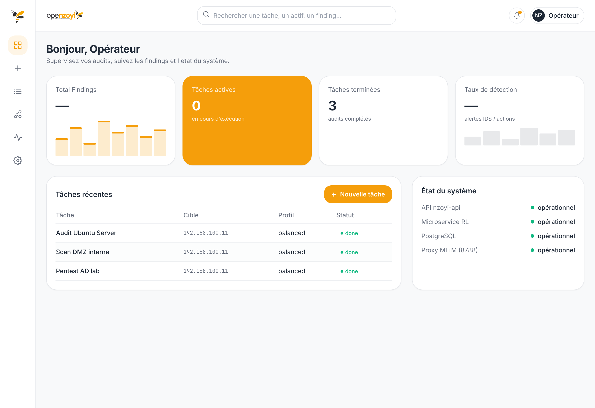
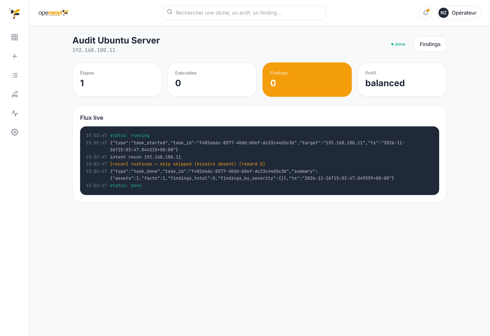
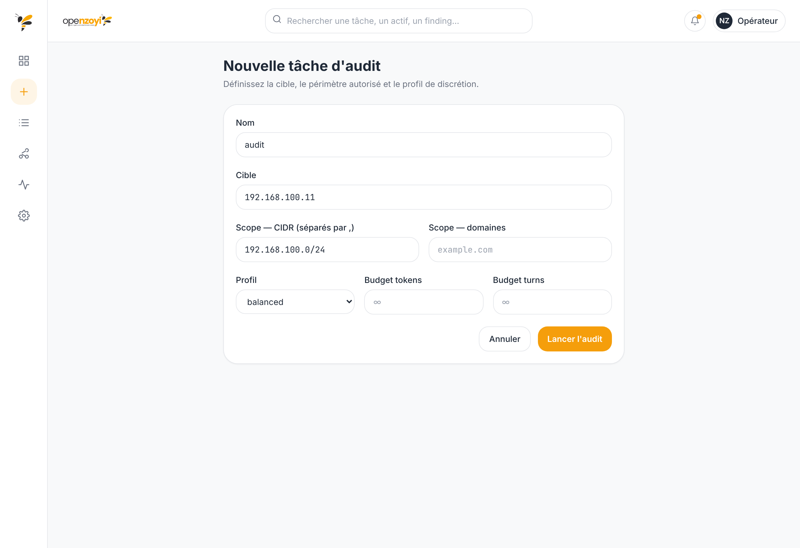

<p align="center">
  
</p>

<p align="center">
  
</p>

<p align="center">
  <strong>Système multi-agents autonome qui découvre, exploite et prouve des vulnérabilités<br>
  sur Ubuntu / Windows Server — en contournant IDS et SDN grâce à un moteur d'évasion par renforcement.</strong>
</p>

<p align="center">
  
  
  
</p>

<p align="center">
  
  
  
  
  
</p>

---

## Qu'est-ce qu'Open'Zoyi ?

Open'Zoyi (*nzoyi* = « abeille » en lingala) est un **outil d'audit offensif
autonome**. Vous lui donnez une cible et un périmètre ; une équipe d'agents
spécialisés enchaîne reconnaissance → analyse → exploitation → post-exploitation,
**apprend à rester discrète** face à Suricata et aux règles SDN, et produit des
**findings vérifiés avec preuves capturées**.

Ce qui le distingue d'un scanner classique :

- 🐝 **Multi-agents sur un graphe partagé** — Planner (stratégie) + Dispatcher
  (tactique) + workers spécialisés, une seule mémoire (graphe d'exploration).
- 🧠 **Évasion apprise par renforcement** — un Q-Learning tabulaire choisit
  outil, timing, délai et fragmentation pour minimiser les alertes IDS.
  **Jamais de LLM dans cette boucle** (contrainte d'architecture vérifiable).
- 🛡️ **Garde-fous déterministes** — scope gate, interception des actions
  destructrices, budgets, borne de débit réseau, lab restaurable.
- 🧾 **Preuves liées aux findings** — proxy MITM qui capture requête + réponse.
- 🎛️ **UI temps réel** — création de tâche, flux live (SSE), tableau de findings.

> Open'Zoyi s'utilise **exclusivement** sur un lab **que vous contrôlez** et
> êtes **autorisé** à tester. Voir [`docs/SECURITY.md`](docs/SECURITY.md).

---

## Aperçu de l'interface

<p align="center">
  
  <br><sub>Dashboard — cartes de résumé, tâches récentes, état du système (charte OpenZoyi).</sub>
</p>

<table>
  <tr>
    <td width="50%">
      
      <br><sub><b>Vue live</b> — flux SSE des tool calls, décisions du RL, compteurs.</sub>
    </td>
    <td width="50%">
      
      <br><sub><b>Nouvelle tâche</b> — cible, scope, profil de discrétion, budgets.</sub>
    </td>
  </tr>
</table>

---

## Architecture

```
                         ┌───────────────────────────┐
                         │         nzoyi-web          │  UI Next.js 15
                         │  dashboard · live · findings│  (palette OpenZoyi)
                         └─────────────┬──────────────┘
                                       │ REST + SSE
                         ┌─────────────▼──────────────┐
                         │          nzoyi-api          │  Orchestrateur
                         │  Planner → Dispatcher        │  FastAPI
                         │  ├─ gates (scope/intercept/  │
                         │  │   budget/untrusted)       │
                         │  ├─ noise governor           │
                         │  ├─ tools/ (catalogue)       │
                         │  ├─ graph/ (expl. + assets)  │
                         │  └─ evidence/ (MITM 8788)    │
                         └───────┬──────────────┬───────┘
                       next_action│      update │
                         ┌────────▼──────────────▼──────┐
                         │         nzoyi-core           │  Microservice RL
                         │  Q-Learning (sans LLM)       │  FastAPI
                         │  state 1512 · action/phase   │
                         └──────────────┬───────────────┘
                                        │
                               ┌────────▼────────┐
                               │   PostgreSQL     │  tâches, graphe, findings,
                               │   (13 tables)    │  preuves, Q-tables, secrets
                               └──────────────────┘
```

**Boucle d'exécution :** `graphe → Planner → intent → Dispatcher`
→ `scope ✓ · interception ✓ · budget ✓` → `RL.next_action` → `governor.clamp`
→ `tool.run` → `evidence.capture` → `reward` → `RL.update` → write-back graphe.

Détails : [`docs/ARCHITECTURE.md`](docs/ARCHITECTURE.md).

---

## Démarrage rapide (Docker)

```bash
git clone https://github.com/14juanito/Projet-Nzoyi.git
cd Projet-Nzoyi
cp .env.example .env            # ajuste POSTGRES_PASSWORD, etc.
docker compose up -d            # db + core (RL) + api + web
```

| Service | URL |
|---------|-----|
| Interface | http://localhost:3000 |
| API | http://localhost:8000 |
| Microservice RL | http://localhost:8800 |

Les migrations PostgreSQL s'appliquent automatiquement au démarrage. Les
binaires offensifs (nmap, nuclei, …) ne sont pas inclus dans les images :
installez-les dans votre lab (voir [`docs/LAB_SETUP.md`](docs/LAB_SETUP.md)).

### En ligne de commande

```bash
cd nzoyi-api
python main.py --target 192.168.100.11 --scope 192.168.100.0/24
# → results/report_*.json (actifs, findings, graphe)
```

---

## Catalogue d'outils

Chaque outil est un **wrapper** autour d'un binaire standard (aucun payload
embarqué) ; il dégrade proprement (`skipped`) si le binaire est absent. Le RL
choisit l'outil au sein de la phase.

| Phase | Outils |
|-------|--------|
| **recon** | nmap · rustscan · httpx · subfinder |
| **vuln** | nuclei · ffuf · sqlmap · nikto |
| **ad_enum** | netexec · impacket · bloodhound · sharphound |
| **linux** | linpeas · linux-exploit-suggester |
| **lateral** | impacket · evil-winrm · chisel |
| **evasion** | sdn-toolkit · iodine · scapy |
| **post** | mimikatz · winpeas · rubeus · certipy |

---

## Garde-fous & sécurité

| Garde-fou | Rôle |
|-----------|------|
| **Scope gate** | Refuse toute cible hors CIDR/domaine déclaré (+ anti-invention) |
| **Interception gate** | Actions destructrices gatées (modes autonome / semi-autonome), règles string/regex/argv_prefix |
| **Budget** | Plafond tokens/turns, wrap-up forcé |
| **Noise governor** | Plafonne le débit par profil — **borne** le RL (il propose, le governor clampe) |
| **Untrusted boundary** | Sorties d'outils encadrées par nonce (data, jamais instruction) |
| **Kill + restore** | Annule les workers, défait les persistances, remet le lab aux snapshots |

Le moteur d'évasion est **libre** d'optimiser objectif + discrétion ; ce sont
les *gates* (code déterministe), pas une récompense, qui bloquent le hors-scope
et le destructeur. Voir [`docs/SECURITY.md`](docs/SECURITY.md).

---

## Évasion par renforcement (sans LLM)

Le cœur tactique est un **Q-Learning tabulaire** isolé dans le microservice
`nzoyi-core`. Il observe un état discret (OS cible, ports ouverts, privilèges,
alertes 5 min, blocages SDN, phase — **1512 états**) et choisit une action
`{outil, timing, délai, fragmentation}` pour maximiser :

```
reward = objectif_atteint − 10·alertes − 0.1·temps − 5·quarantaine
```

Aucun LLM ne touche cette boucle (contrainte vérifiée en CI) :

```bash
grep -rn "llm" nzoyi-core/evasion/    # → 0 résultat
```

Les couches LLM (stratégie, triage, raffinement, rationale) restent cantonnées
à l'orchestrateur et disposent toujours d'un **repli déterministe**.

---

## Structure du projet

```
Projet-Nzoyi/
├── docker-compose.yml          # db + core + api + web
├── .env.example
├── nzoyi-core/                 # microservice RL (FastAPI, sans LLM)
│   └── evasion/                # q_learner, state (1512), action/phase, policy_store
├── nzoyi-api/                  # orchestrateur
│   ├── agents/                 # planner, dispatcher, noise_governor, evaluation
│   ├── tools/implementations/  # catalogue (wrappers)
│   ├── gates/                  # scope, interception, budget, untrusted, lifecycle
│   ├── evidence/               # mitm_proxy (8788), capture
│   ├── graph/                  # exploration + assets
│   ├── server.py               # API HTTP + SSE
│   └── main.py                 # CLI
├── nzoyi-web/                  # UI Next.js 15 (palette OpenZoyi)
├── db/migrations/              # Alembic (13 tables)
├── scripts/
│   ├── verify.sh               # CI locale (tests + gate LLM + smoke RL)
│   └── restore_lab.sh          # snapshots libvirt
└── docs/                       # ARCHITECTURE · SECURITY · LAB_SETUP
```

---

## Vérification

```bash
bash scripts/verify.sh
#   [1/4] 72 tests d'origine (non-régression)
#   [2/4] 0 référence LLM dans nzoyi-core/evasion/
#   [3/4] smoke microservice RL
#   [4/4] 45 tests nzoyi-api (outils, graphe, boucle E2E, gates, serveur)
```

---

## Environnement de lab

Banc **KVM/libvirt** isolé (`nzoyi-lab` 192.168.100.0/24, sans egress) :
Kali (attaquant) + Ubuntu Server 24.04 (Suricata 8.0.6, services cibles) ;
cible Windows Server en projet. Guide complet :
[`docs/LAB_SETUP.md`](docs/LAB_SETUP.md).

---

## Avertissement légal

Open'Zoyi est destiné **exclusivement** à la recherche et aux tests de
pénétration **autorisés** sur un réseau **isolé que vous contrôlez**. Ne jamais
l'utiliser contre des systèmes sans autorisation écrite explicite. L'auteur
décline toute responsabilité en cas d'usage illégal.

## Auteur

**Jean El-rohi Mukendi** — Faculté des Sciences Informatiques, Université
Protestante au Congo (UPC).

<p align="center">
  
</p>
